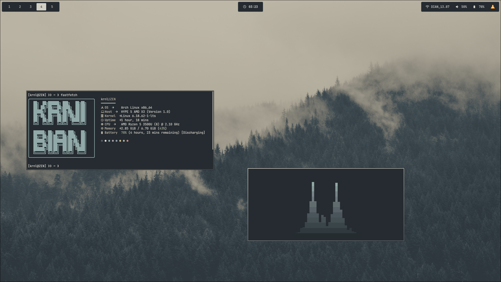
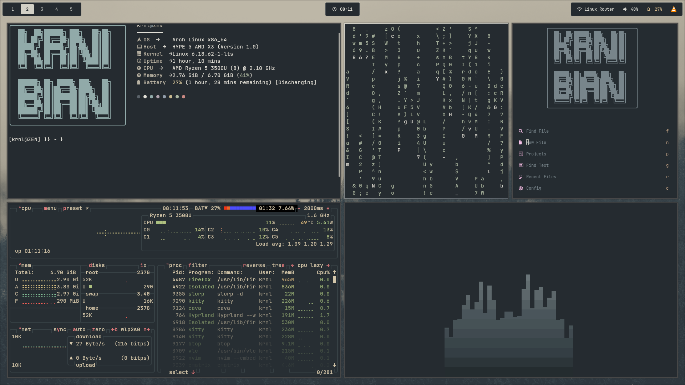

<div align="center">

# ❄ KRNL-DOTS

### Your Linux. Your Own Way.

A personal Arch Linux + Hyprland configuration.

<br>


<br>



<br>

**Minimal · Lightweight · Personal**

*Built because the default desktop wasn't enough.*

</div>

---

## 01. About

**KRNL-DOTS** is my personal collection of Linux configurations, built and customized for my daily workflow.

Running on Arch Linux with Hyprland, this setup focuses on:

- A clean and minimal desktop.
- Lightweight performance.
- Consistent visual design.
- A comfortable terminal experience.
- Easy customization.

This project is constantly evolving as I experiment with new configurations and ideas.

## 02. Desktop Preview

<div align="center">

### Main Desktop


### Another Look



*My current Linux rice. More updates coming.*

</div>

## 03. What's Inside?

| Component | Description |
|:--|:--|
| Hyprland | Dynamic tiling window manager |
| Waybar | Custom status bar |
| Kitty | Terminal emulator |
| Fastfetch | System information |
| Fuzzel | Application launcher |
| Cava | Audio visualizer |
| Swaybg | Wallpaper manager |
| Hyprlock | Screen locker |
| Hyprshot | Screenshot utility |

## 04. Requirements

Before installing, make sure you have:

- Arch Linux
- Internet connection
- Git
- Sudo privileges
- A working Hyprland environment

### Dependencies

The installer handles the required packages:

```text
cava
fastfetch
fuzzel
hyprland
kitty
waybar
swaybg
stow
```

## 05. Installation

Ready to try KRNL-DOTS?

**1. Clone the repository**

```bash
git clone https://github.com/bianapple1-maker/KRNL-DOTS.git
```

**2. Enter the directory**

```bash
cd KRNL-DOTS
```

**3. Run the installer**

```bash
chmod +x install.sh
./install.sh
```

Wait for the installation process to finish.

> [!WARNING]
> This installer is designed specifically for Arch Linux.
> Do not execute it as root.

## 06. Project Structure

```text
KRNL-DOTS/
│
├── assets/
│   ├── preview.png
│   └── preview2.png
│
├── cava/
│   └── .config/cava/
│
├── fastfetch/
│   └── .config/fastfetch/
│
├── fuzzel/
│   └── .config/fuzzel/
│
├── hypr/
│   └── .config/hypr/
│
├── kitty/
│   └── .config/kitty/
│
├── waybar/
│   └── .config/waybar/
│
├── install.sh
└── README.md
```

## 07. Wallpaper Configuration

Want to change your wallpaper?

Open:

```bash
~/.config/hypr/hyprland.lua
```

Find the Swaybg startup configuration and replace the wallpaper path with your own image location.

Save the file and restart the wallpaper process.

## 08. Backup & Safety

Don't worry about your previous configurations.

KRNL-DOTS installer creates a backup of existing configuration files before replacing them.

Backup location:

```text
~/.config/krnl-backup-YYYYMMDD-HHMMSS
```

Your previous configuration files are kept safe in a separate directory.

## 09. Make It Yours

Feel free to customize anything:

- Colors and themes.
- Keybindings.
- Window layouts.
- Wallpapers.
- Terminal appearance.
- Waybar modules.

These are dotfiles, not sacred artifacts.

Break something, learn something, fix it, and make it yours.

## 10. About the Developer

<div align="center">

### Bian

Linux enthusiast · Developer · Tinkerer

I enjoy exploring Linux, experimenting with configurations, and building things from scratch.

**Built with curiosity and a lot of terminal commands.**

</div>

---

<div align="center">

### KRNL-DOTS

*Your Linux. Your Own Way.*

Made with Linux by **Bian**.

</div>
